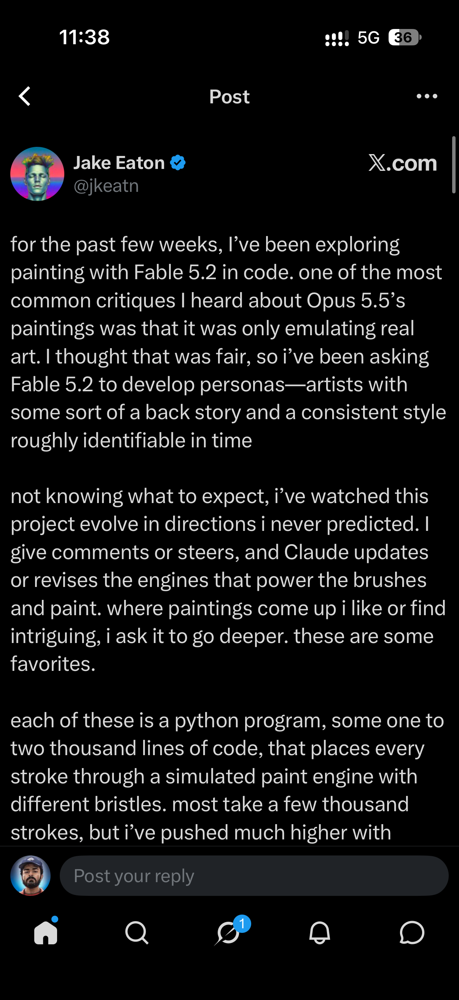
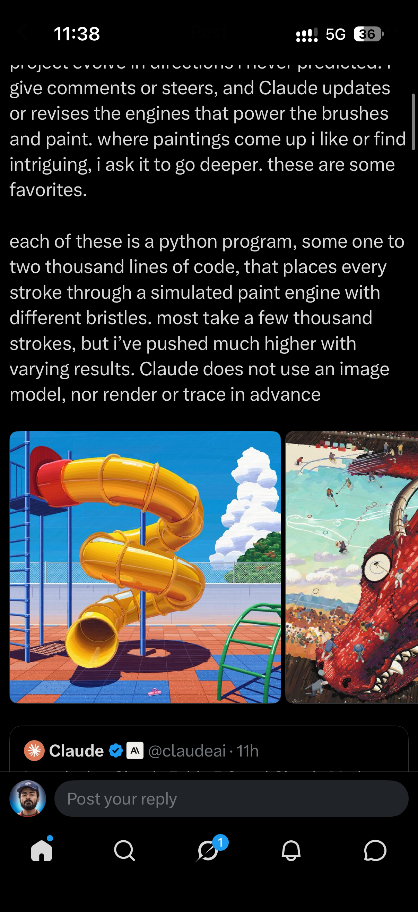

## Summary
Jake Eaton (@jkeatn) has been painting with Fable 5.2 in code. To answer the critique that AI paintings only emulate real art, he has Claude invent artist personas with a backstory and a consistent, period-identifiable style, then steers it while it revises the brush and paint engines. Each painting is a Python program of 1-2k lines that places every stroke (usually a few thousand) through a simulated paint engine with different bristles: no image model, no pre-rendering or tracing.

Screenshots of the X post text, plus two example paintings: a glossy yellow spiral tube slide on a blue-and-red tiled playground with clouds and a green climbing frame, and a huge red dragon's head looming over a crowded ice rink full of skaters. The post quotes @claudeai's launch post.

## Raw
https://x.com/jkeatn/status/2119874007382299087?a=qmaQJLw2n-8etCxrBCc&s=46
(plus 2 screenshots of the post)

## Notes
Idea worth trying for game art: procedural, code-placed brush strokes instead of image models.
