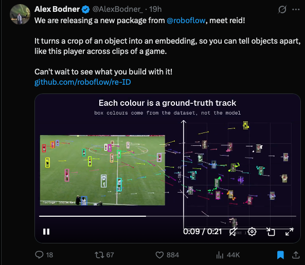

## Summary
`reid` is an open-source (Apache 2.0) Python package from Roboflow that turns a crop of a person into an appearance embedding, so the same person can be matched across frames, clips or cameras. It loads pretrained OSNet and FastReID models, works with `supervision` detections from any detector (e.g. RF-DETR), and includes benchmarks for re-identification. Install with `pip install -U reid`; docs at reid.roboflow.com.

Screenshot of Alex Bodner's X post announcing reid, with a demo video: football players boxed on a pitch next to a t-SNE plot where each colour is one player's track, showing crops of the same player clustering together.

## Raw
https://x.com/AlexBodner_/status/2119869708832805344?a=HlVPKugADUb2xcnfk1k&s=20
(plus screenshot of the post)

## Notes
Could be handy for sports video edits: tracking one player across clips.
