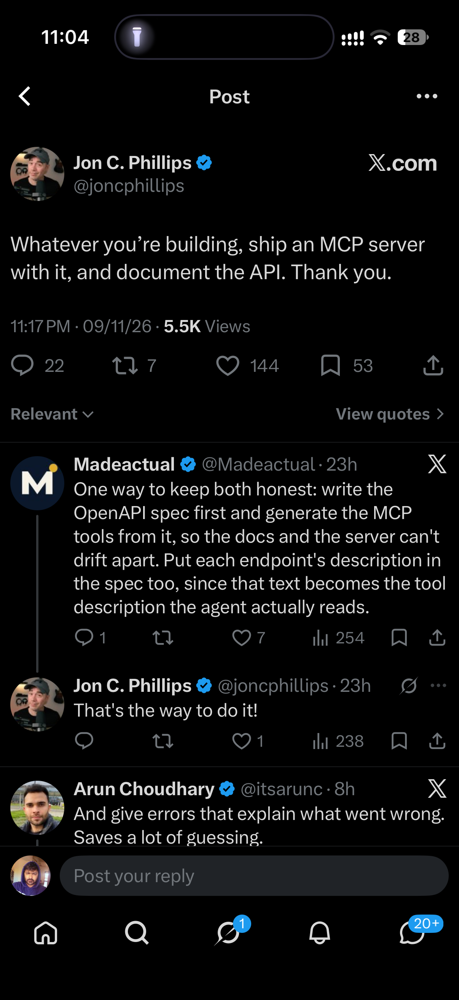

## Summary
Jon C. Phillips (@joncphillips): "Whatever you're building, ship an MCP server with it, and document the API." Best replies: write the OpenAPI spec first and generate the MCP tools from it so docs and server can't drift apart, put each endpoint's description in the spec since that text becomes the tool description agents read, and return errors that explain what went wrong.

Screenshot of the X post (09/11/26, 5.5K views) with replies from @Madeactual (OpenAPI-first tip, which Jon endorsed: "That's the way to do it!") and @itsarunc (clear error messages).

## Raw
(screenshot of the post)

https://x.com/joncphillips/status/2119849328776819015?a=Z3l5nVctRmqPxIZ0jaM&s=46 link to the ss i shared

## Notes
Related: [[2026-11-10-patch-gamedev-platform]] (ships its tools as a CLI and MCP).
