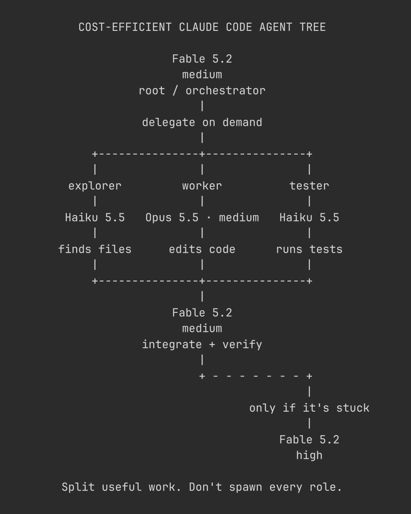

## Summary
A Claude Code tip from @Voxyz_ai: a cost-efficient agent tree where Fable 5.2 (medium effort) is the root orchestrator and only delegates on demand, Haiku 5.5 handles finding files and running tests, and Opus 5.5 (medium) edits code. Fable then integrates and verifies the results, and switches to high effort only if it gets stuck. It follows Anthropic's new model selection guide, and the image is meant to be handed to Claude Code to set it up.

Image: an ASCII diagram titled "Cost-efficient Claude Code agent tree". Fable 5.2 medium is the root/orchestrator and branches to explorer (Haiku 5.5, finds files), worker (Opus 5.5 medium, edits code) and tester (Haiku 5.5, runs tests). They merge back into Fable 5.2 medium for integrate + verify, with a dashed branch to Fable 5.2 high "only if it's stuck". Footer: "Split useful work. Don't spawn every role."

## Raw
https://x.com/voxyz_ai/status/2120199820887593304?a=b908V0171pUheO52HyM&s=46

## Notes
- Read via Social Reader (single post + image).
- Related: [[2026-11-10-ship-mcp-server-tip]]
