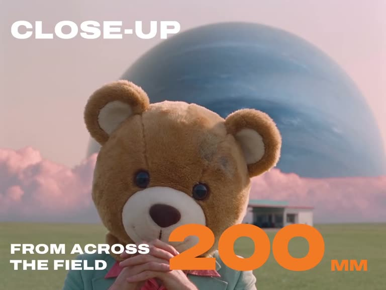

## Summary
A ~39-second AI-film reel from @lemon_carpet (made with Seedance) explaining how lens focal length changes a shot, so you can ask for it in AI video prompts. The point: "close-up" alone means nothing; the lens does. A 50mm medium shot is "what your eyes see", a 200mm close-up shot "from across the field" compresses the background so a giant planet looms behind the subject, and wide shots shrink the subject into a huge landscape. Useful as a cheat sheet for prompting camera language in AI video tools.

Frames: a faceless white-masked figure in chainmail and a sequinned cloak on a blue wingback chair in a green field ("Because close-up means nothing"); a person in a teddy-bear head and mint suit labelled "Medium, what your eyes see, 50mm"; the same bear at "Close-up, from across the field, 200mm" with a huge blue planet and pink clouds behind; a wide shot of the chair tiny in an empty field beside a lone petrol station under the planet. Surreal pastel look, bold white and orange labels.

## Raw
https://www.instagram.com/reel/DfnLpaPoNIf/?exln=NGpjOXc5NGVnaTB4

## Notes
- Caption: "Comment LENS and I'll send you my lens cheat sheet. #aivideo #seedance #aifilm #promptengineering #cinematography"
- Read via Social Reader (caption + 4 video frames). No comment from Yuvraj, so filed as a technique.
- Related: [[2026-11-12-impossible-weapon-knight-animation]]
