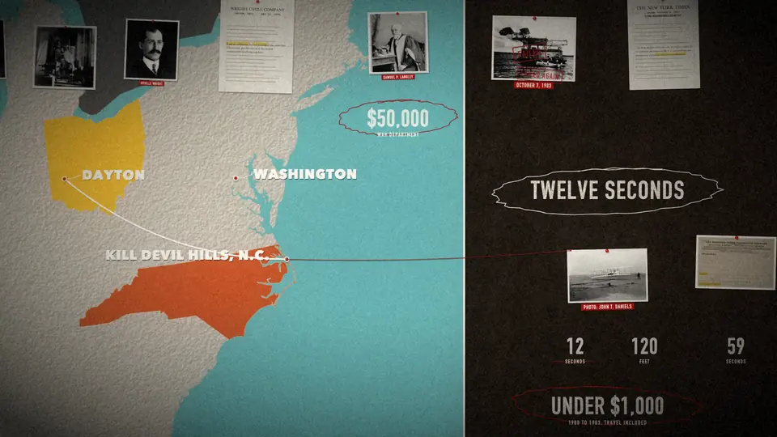

## Summary

Cinematic Skill (MIT, by exploraX) is an agent skill for Claude Code, Codex, Cursor, Gemini CLI and others that makes narrated explainer and documentary films entirely from code. Ask for e.g. "a 90 second documentary about the Wright brothers" and the agent researches and writes the script, records a voice, pulls public-domain photos from Wikimedia Commons with licences, and builds one continuous camera move over a single designed world drawn in Skia (Python), so stamps, highlighters and counters hit on the exact narrated word. It then adds synthesised SFX, an optional score and burned-in captions, stopping for approval after the beat table, the look and a 30 s draft. Looks: cork evidence wall, studio, blueprint, night.

The image is the final frame of the example film "Twelve Seconds": a cork wall with a US map (Ohio and North Carolina filled, a route from Dayton to Kill Devil Hills), portraits, a typeset letter, Langley's failed machine with stamps and the 1903 first-flight photo with counters.

## Raw
https://github.com/Moh4696/cinematic-skill

This is a skill, agent skill for explainer content.

## Notes
- Install: `npx skills add Moh4696/cinematic-skill` (or Claude Code `/plugin marketplace add Moh4696/cinematic-skill`). Needs skia-python, numpy, pillow and ffmpeg.
- Same author: Open 3D Skills (three.js scenes, scroll films).
- Related: [[2026-11-11-ai-tween-paint-harness]]
