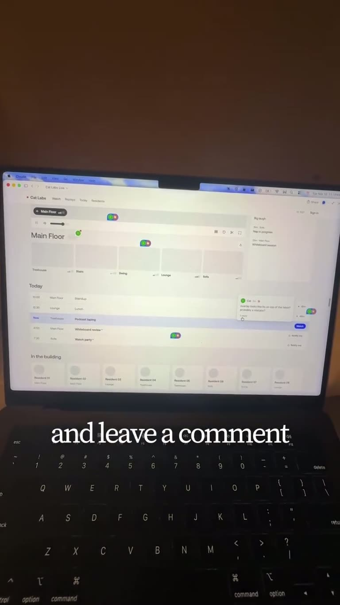

## Summary

A reel from @askcatgpt showing her "newest creative obsession with Claude": she opens a UI she's building (a "Cat Labs Live" dashboard with room thumbnails, a Today schedule and a residents row) inside the Claude desktop app, clicks on a spot and leaves a comment right on the page (e.g. "overlay looks like it's on top of the table? probably a mistake?"), and Claude edits the live UI in place. In one example she asks for upcoming days and within about 30 seconds the Today list becomes a Schedule with a day picker. Point: point-and-comment UI tweaks without explaining layout in words or asking someone else.

The frame shows the Claude desktop window with the light dashboard, coloured comment pins scattered over it and a comment popover on the right; caption "and leave a comment".

## Raw
https://www.instagram.com/reel/Dfp_I12BZ_Z/?psln=dzRha2d5aGhodzJ5

Claude using trick

## Notes
- Caption: "TLDR Claude live editing my UI with me is absolutely bananas… This stuff used to take days guys. DAYS."
- Related: [[2026-11-11-claude-code-agent-tree]]
