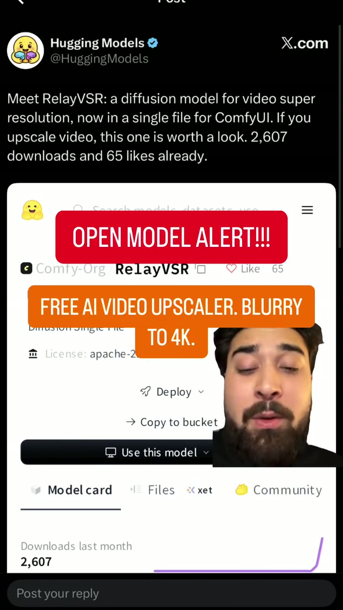

## Summary

RelayVSR is an open-weight (Apache 2.0) diffusion model for video super-resolution, published by Comfy-Org on Hugging Face as a single file and loaded natively in ComfyUI since Nov 5, 2026. The LightX2V team also retrained it as RelayVSR X2, a native 2x upscaler (45 FPS on an H100, flicker suppression, two checkpoints) aimed at MiniMax H3 clips, e.g. 768×1344 to 1536×2688. A comparison post says it upscaled a 5-second AI video to 4K in about 50 s on a 16 GB GPU (vs ~7 min with SeedVR2), with sharp hair and eyelashes but stronger skin mottling and slightly more vivid anime colours.

The frame is the reel's opening: a Hugging Models post on X showing the Comfy-Org/RelayVSR model page, with "OPEN MODEL ALERT!!!" and "FREE AI VIDEO UPSCALER. BLURRY TO 4K." overlays.

## Raw
https://www.instagram.com/reel/DfpWJb0BauP/?rpxt=MWFnc3dxNG11MmZmbQ==

Open weight video upscaler available at ConfUI.

## Notes
- Model: https://huggingface.co/Comfy-Org/RelayVSR
- Reel by @asharasjad (same creator as [[2026-11-13-viggle-remake-open-model]]).
