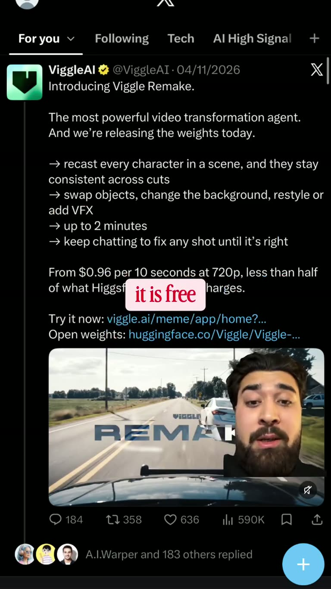

## Summary

Viggle Remake is Viggle AI's video-to-video "transformation agent", with open weights on Hugging Face (`Viggle/Viggle-Remake`). It recasts every character in a scene and keeps them consistent across cuts, can swap objects, change the background, restyle or add VFX, handles clips up to 2 minutes, and you keep chatting to fix a shot. The model card shows ~20B params, wan architecture, GGUF quants (4-bit ~14.3 GB, 6-bit ~17.6 GB, 8-bit ~22.3 GB) and a minimax-h3 community license. Hosted use is from $0.96 per 10 s at 720p.

The frame is a screenshot of Viggle AI's launch post on X with the "REMAKE" demo clip (a car driving down a country road) and the reel's creator talking in the corner.

## Raw
https://www.instagram.com/reel/DfpPt63MPOT/?psln=MXF4ZTUwdjdkeXAwYw==

Wiggle AI's open waits to recast anybody in a video.

## Notes
- Open weights: https://huggingface.co/Viggle/Viggle-Remake
- Reel by @asharasjad; caption: "RECAST ANYONE IN YOUR VIDEO. FREE MODEL."
- Useful for his video editing work (character swaps in footage).
