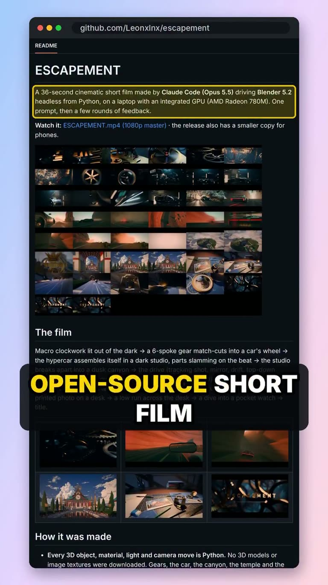

## Summary

Escapement is a 36-second cinematic short film made by Claude Code driving Blender headless from Python on a laptop with an integrated GPU. No downloaded models or textures: every object, material, light and camera move is a script. Five builder agents made the five acts in parallel, a director agent critiqued each act, and a second pass applied the fixes. Edit, grade, halation, grain and sound mix are code too (numpy + ffmpeg), cut to a 120 BPM beat grid. Open source (MIT) at https://github.com/Leonxlnx/escapement, with the brief, shot table and the agents' iteration logs; tuned for one Windows laptop and renders take hours on an iGPU.

The frame shows the repo README: a contact sheet of stills (macro gears, a hypercar assembling in a dark studio, a dusk orange canyon drive, a temple under clouds, a desk with a pocket watch) and the "How it was made" section. Reel by @aiwithbibek.

## Raw
https://www.instagram.com/reel/DfpnVGBBawT/?psln=bGwxaHZvaDJqczJh

This is a cool 3D short film skill. It also has a link of the repo in the caption, so add that link too.

## Notes
Repo: https://github.com/Leonxlnx/escapement
