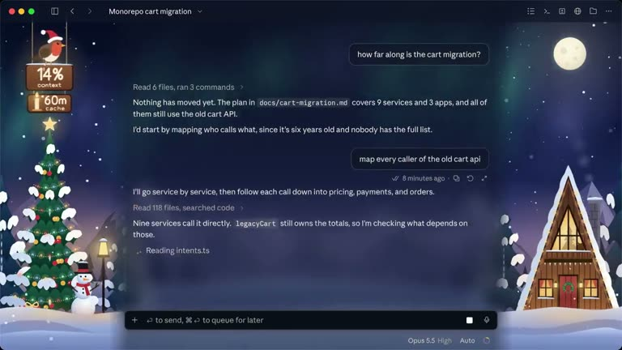

## Summary
Lydia Hallie (@lydiahallie) shows that Claude Code desktop custom themes are really mods, so the background can react to the live session. She asked Claude for a theme where it snows harder as the context fills up; the mod hooks into `turn.step`. It quotes the @ClaudeDevs launch post: you can build custom themes for Claude Code on desktop with mods (colours, animated backgrounds), by describing the look to Claude or starting from the theme-examples plugin.

Video frame: the Claude Code desktop app over a snowy night scene with a full moon, aurora, a snow-covered Christmas tree and snowman on the left and a lit A-frame cabin on the right. A robin in a Santa hat sits on hanging wooden signs that read "14% context" and "60m cache"; the chat column is a frosted dark panel. Across the 14s clip the context climbs to 44% and 91% with snow piling up, then `/compact` drops it back to 4% and the cache sign empties.

## Raw
https://x.com/lydiahallie/status/2122028598639136810?a=sPndKhrzA-xI2Sec2MY&s=46

Insane use case for custom theme or mods.

## Notes
Idea: a pixel-art or game-styled Claude Code theme whose scene reacts to context, cost or tool calls.
