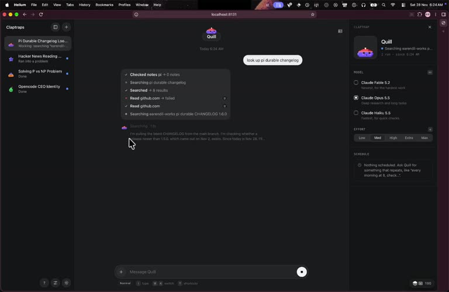

## Summary

Sree (@eersnington) shows an early alpha of a simple Grok-bot-style agent app built entirely with Effect, effect/ui and Rivet Effect clusters. Each agent is a "claptrap" with its own wobbly pixel-art mascot (the first one is Quill) that searches the web, runs code, keeps notes, asks when it needs you and runs routines while you're away. It has MCP support and durable background agents, and you can schedule a task in plain words ("check this daily at 9am").

The frame shows the three-pane dark UI: a list of claptraps on the left (each with a status like Working or Done), the chat in the middle with a live checklist of steps (Checked notes, Searched, Read github.com -> failed), and a right panel with the agent's mascot, a model picker (Claude Fable 5.2, Opus 5.5, Haiku 5.5), effort levels Low to Max, and a schedule box. The start screen is a pixel-art purple blob with a red hat above "What should we work on?".

## Raw
https://x.com/eersnington/status/2126508796944199946

## Notes
- Quotes his earlier post: "effect ui devtools are insanely good".
- [[claude-code-reactive-theme]]: also a playful, characterful skin on an agent chat
- [[cloudflare-computer-agent-sandbox]]: also agents that keep running in the background
- [[obsidian-hermes-agent-workflow]]: same idea of agents running routines on a schedule while you're away
