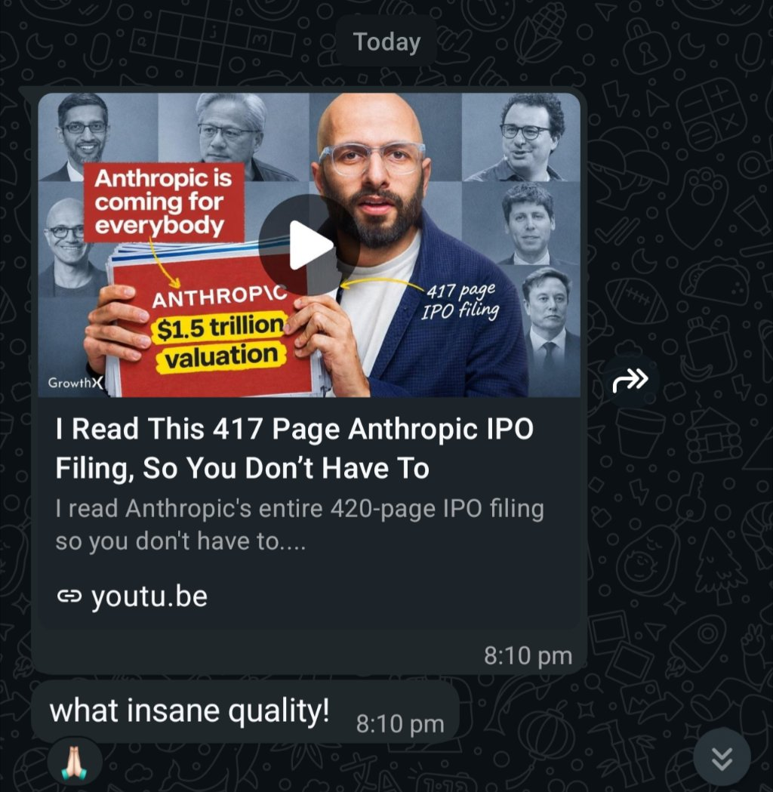

## Summary
Udayan Walvekar (@udayan_w) says a polished GrowthX YouTube video, "I Read This 417 Page Anthropic IPO Filing, So You Don't Have To", was edited entirely in Claude, with 360 GB of files rendered through it. Proof point that an agent can drive a real long-form edit end to end. The post shares no workflow details, only the claim and a screenshot.

Screenshot: a dark-mode WhatsApp chat with a YouTube link preview. The thumbnail shows a bald, bearded host in clear glasses and a navy blazer holding a red document reading "ANTHROPIC $1.5 trillion valuation", a red sticker "Anthropic is coming for everybody", a hand-written "417 page IPO filing" arrow, and a grid of grey-toned tech CEO headshots behind him, GrowthX logo bottom left. Below it someone replied "what insane quality!".

## Raw
https://x.com/udayan_w/status/2122732735496355860?a=yTiNqG_pZrV5YODXZKA&s=46

## Notes
- [[opus-presentation-prompt]]: both claude
