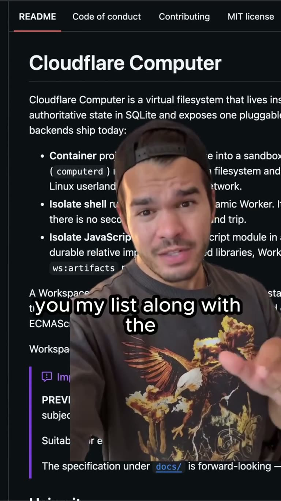

## Summary
Cloudflare open-sourced Cloudflare Computer (`@cloudflare/computer`, MIT), a persistent "computer" for AI agents: a virtual filesystem that lives inside a Durable Object with its state in SQLite, so an agent's files survive after a session ends. One `workspace.runtime.exec()` call runs code on a pluggable backend: a full Linux sandbox container (FUSE-mounted via `computerd`), a just-bash shell in a Dynamic Worker, or "codemode" JavaScript modules with git and artifact helpers. Found via an Instagram reel by @angelotrifanoff.ai.

Reel frame: a creator talking over the cloudflare/computer GitHub README, which lists the Container, Isolate shell and JavaScript backends; captions say it gives your AI a computer that keeps working after the session ends.

## Raw
https://www.instagram.com/reel/Db2FJERS0N_/?mdxt=bmpkcmI2NTQ1dzl

Cloudflare computer

## Notes
Reel: https://www.instagram.com/reel/Db2FJERS0N_/
