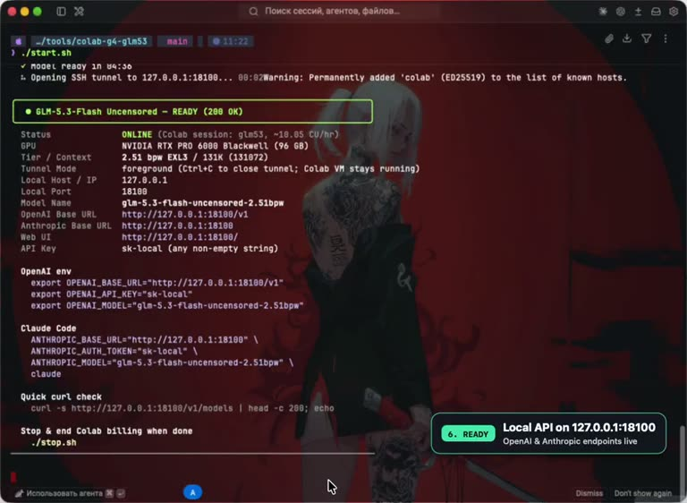

## Summary

Alexey Fateev (@superalesha) shares a one-script launcher (`colab-g4-glm53` in his `alesha-pro/tools` repo) that starts GLM-5.3-Flash Uncensored (321B, an "abliterated" open model with refusals removed) on a Google Colab G4 machine (RTX PRO 6000 Blackwell, 96 GB VRAM) in about 10 minutes. It opens an SSH tunnel to `127.0.0.1:18100` with OpenAI-style and Anthropic-style endpoints (tool calls, thinking, vision), so Claude Code, Codex or OpenCode can use it like a local API. Google AI plans include Colab compute units and G4 costs ~10 CU/hr, so Pro ($20/mo) gives ~20 hours, Ultra 5x ~99 and Ultra 20x ~199. Default 2.51 bpw quant runs ~102 tok/s at 131K context; heavier 3.05 and 4.05 bpw tiers are slower. `stop.sh` shuts it down so idle time doesn't burn units.

The frame is a terminal showing the launcher's READY screen: status online on the RTX PRO 6000, the 2.51 bpw tier with 131K context, local port 18100, and ready-to-paste env vars for OpenAI and Claude Code (`ANTHROPIC_BASE_URL`, model `glm-5.3-flash-uncensored-2.51bpw`).

### Like I'm 5
Your Google AI subscription quietly comes with time on a very big, very expensive computer in Google's building. This script borrows that computer, puts a huge free AI brain on it, and runs a pretend wire back to your laptop. Then your coding helpers (like Claude Code) can talk to that brain as if it lived on your own computer. When you're done you press stop, so you don't use up your hours.

## Raw
https://x.com/superalesha/status/2126011712692224264?a=9SaMscaRJQ_3J0mFoos&s=46

Also add an explaination on the note and here in chat lia5

## Notes
- Repo: https://github.com/alesha-pro/tools/tree/main/colab-g4-glm53 (`./start.sh`, `./stop.sh`)
- Worth checking before use: Colab's terms on long-running SSH/tunnel use, and that it's a third-party uncensored model, so its output quality isn't the same as Claude's.
- [[model-routing-orchestrator-prompt]]: another way to route coding work to cheaper models
