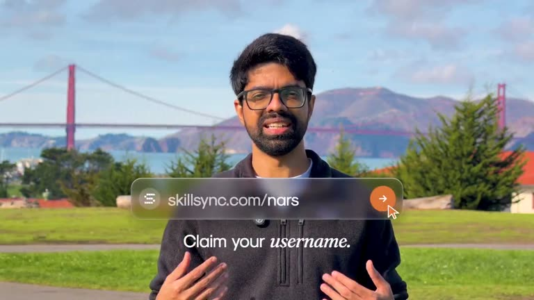

## Summary
Skillsync, launched by Nars (@narsagna) on X on 2026-11-24, pitches itself as "the substack for skills": a place to publish the skills you build for your AI agents and have people and agents pay to use them, instead of leaving them scattered across GitHub, Slack and Google Drive. You claim a username at skillsync.com (profile URLs look like skillsync.com/nars).

The 53-second launch video is the founder talking to camera in front of the Golden Gate Bridge, cut with kinetic type (a clean sans mixed with a big white italic serif, "is stuck."), a glassy dark card for a skill called "write-like-me", a floating "skills_final_v3.zip" Slack attachment, and a frosted URL bar reading "skillsync.com/nars" with an orange arrow button and "Claim your username."

## Raw
https://x.com/narsagna/status/2125258650520563740?a=K_qlpGGH9JV9ClU4fsA&s=46

Post text (via Social Reader): "The skills you build for your agents are your real edge / right now, they're scattered across github, slack and dare I say google drive / today we're introducing skillsync, the substack for skills / publish your skills, get people and agents to pay to use them / got skills?"
Thread reply: "claim your username: https://skillsync.com"

## Notes
Related skills already saved: [[unslop-ui-skill]], [[cinematic-film-skill]].
