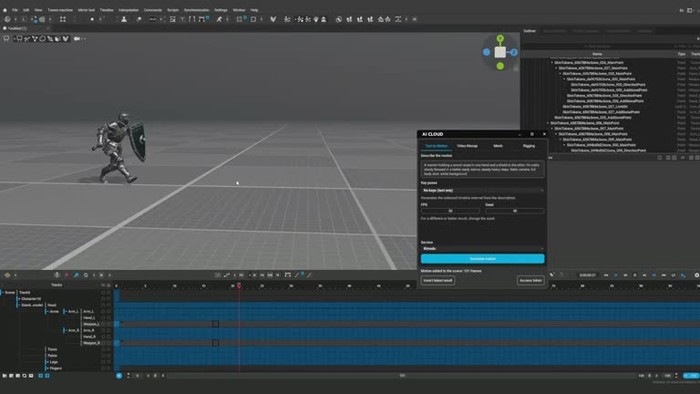

## Summary
Release video (3.5 min) for Cascadeur 2026.3, the physics-assisted 3D character animation tool, posted by Eugene Dyabin. New in this version: IK chains (multi-legged creatures and long chains like tails, with an auto Walk tool that steps every leg), a MetaHuman facial rig with a control picker, override animation layers, AI Cloud (text-to-motion, mesh generation and auto skinning, new video mocap) and a new MCP server so AI agents can drive it.

Frame from the video: the AI Cloud panel with Text to Motion, Video Mocap, Mesh and Rigging tabs, generating a motion from a written prompt ("a warrior holding a sword in one hand and a shield in the other...") for an armoured knight walking on Cascadeur's grey grid. Other frames show a spider-like robot walking over a dome with the Chain IK tools, a MetaHuman face with its facial control picker, and a robot character with override layers.

## Raw
https://x.com/EugeneDyabin/status/2125937757151285478?a=yTzg4f-m_aBKUJ8bC50&s=20

## Notes
- [[blender-mcp-storybook-hero-workflow]]: same idea of an AI agent driving a 3D tool over MCP for character work
- [[toyxyz-blender-retargeter]]: another tool for getting mocap onto characters
- [[procedural-arm-rig-demo]]: IK rigging, like Cascadeur's new IK chains
- [[claude-blender-samurai-build]]: both 3d-character, rigging
