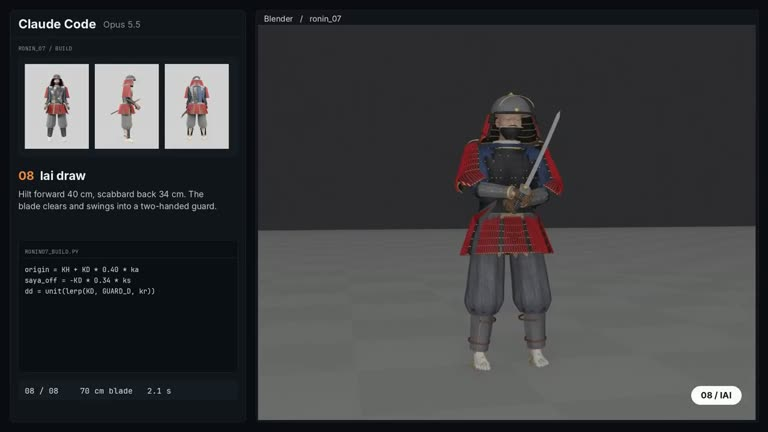

## Summary
Semichenko had Claude Code write all the Python to build a samurai in Blender with zero bought or generated 3D assets: a MakeHuman (MPFB2) body, 9 layers of armour fitted around it, 74 bones, and an iai sword draw. Steps shown: fitted mesh, normal pass, skin weights copied from the 4 nearest body points so armour plates follow the body, then the draw animation. The first render of one frame took 90 s on a laptop CPU; fewer light bounces plus the denoiser got it to 35 s. Quotes an earlier post where the same approach built a neon Tokyo alley ("let opus write the python, then review it inside blender").

Frame: split screen, left a dark Claude Code panel ("08 Iai draw", reference images and a code snippet), right the Blender viewport with the finished samurai in red-laced black armour and kabuto, drawing a katana into a two-handed guard on a grey stage.

The 10 free Blender repos from the thread:
1. Blender MCP (Claude drives a live Blender session): https://github.com/ahujasid/blender-mcp
2. BlenderProc (scenes and renders from one script): https://github.com/DLR-RM/BlenderProc
3. MPFB2 (free CC0 human generator): https://github.com/makehumancommunity/mpfb2
4. Hunyuan3D-2 (open image-to-3D with Blender add-on): https://github.com/Tencent-Hunyuan/Hunyuan3D-2
5. Dream Textures (Stable Diffusion textures in the shader editor): https://github.com/carson-katri/dream-textures
6. BlenderKit (10,000+ free models and materials): https://github.com/BlenderKit/BlenderKit
7. Expy Kit (convert rigs between Mixamo, Rigify, Unreal): https://github.com/pKrime/Expy-Kit
8. ReNim (retarget any mocap onto any rig): https://github.com/anasrar/ReNim
9. Mixamo Converter (fixes Mixamo root motion for engines): https://github.com/enziop/mixamo_converter
10. Sverchok (600+ parametric geometry nodes): https://github.com/nortikin/sverchok

## Raw
https://x.com/semichenkko/status/2125295328861511851?a=vWyTF9Ih9JEiL4LxHR8&s=20

## Notes
- [[blender-mcp-storybook-hero-workflow]]: same idea, Claude driving Blender to make a rigged character
- [[toyxyz-blender-retargeter]]: another free Blender retargeting add-on, like ReNim
- [[cascadeur-2026-3-release]]: AI-assisted character animation tool saved the same day
