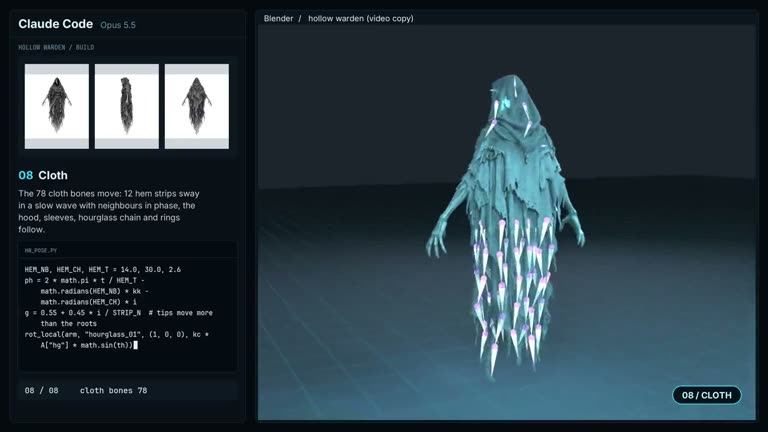

## Summary
Kensei (@0xKense1) had Claude Code take a "Hollow Warden" hooded wraith from one Tripo generation (three views of a character sheet, 395,358 triangles) to a single 80k-triangle game mesh with 129 bones, 78 of them for the torn cloak. The video walks through 8 steps: clean the Tripo mesh, normal map cut to 2048 px (OpenGL format), skin weights blended by region and capped at 4 bones per vertex, then cloth: 12 hem strips swaying in a slow wave, with tips moving more than roots. The thread lists 13 free GitHub projects for the pipeline, and the full workflow is in his linked X article.

Frame: split screen, left a dark Claude Code panel ("08 Cloth", three reference views of the wraith and a Python snippet for the hem wave), right the Blender viewport with the pale cyan hooded wraith, its torn cloak strips marked with glowing bone tips, on a dark teal stage.

The 13 repos from the thread:
1. Blender MCP Bridge (98 MCP tools: geometry, materials, render): https://github.com/seehiong/blender-mcp-bridge
2. Blender MCP Assembly Skill (right scale, catches bad rotations and overlaps): https://github.com/ProfRino/Blender-MCP-Assembly-Skill
3. Spring Bones (spring and bounce on any bone chain, cheap cloak swing): https://github.com/artellblender/springbones
4. ActionPoser (action-constraint rigs, one control moves a whole pose): https://github.com/Arminando/ActionPoser
5. AnimAide (easing and blending keys in the graph editor): https://github.com/aresdevo/animaide
6. Ucupaint (paint-app texture layers inside Blender): https://github.com/ucupumar/ucupaint
7. Material Combiner (merges materials into one atlas, fewer draw calls): https://github.com/Grim-es/material-combiner-addon
8. UVgami (automatic UV unwrapping): https://github.com/danielboxer/UVgami
9. Sverchok (node-based parametric modeling): https://github.com/nortikin/sverchok
10. Tissue (repeats patterns over any surface): https://github.com/alessandro-zomparelli/tissue
11. LeoMoon LightStudio (free studio lighting rig): https://github.com/leomoon-studios/leomoon-lightstudio
12. Camera Shakify (handheld camera shake for turntables): https://github.com/EatTheFuture/camera_shakify
13. PSK/PSA (meshes and animations in and out of Unreal's psk/psa): https://github.com/DarklightGames/io_scene_psk_psa

## Raw
https://x.com/0xKense1/status/2126061549563326606?a=DJdzoGIGRg8vS_9yNFw&s=20

## Notes
- [[claude-blender-samurai-build]]: same Claude-drives-Blender character build with a free repo list (Sverchok is on both)
- [[blender-mcp-storybook-hero-workflow]]: same trick of giving the cloak/scarf its own bone chain so it swings
- [[ai-texturing-blender-addon]]: another way to texture in Blender, next to Ucupaint
