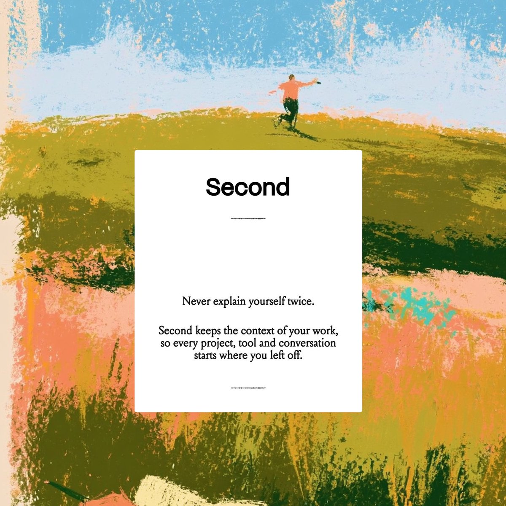

## Summary
Ayush Soni's (@ayushsoni_io) brand identity for "Second", an app that keeps the context of your work ("Never explain yourself twice"). The look pairs loose, textured oil-pastel paintings of people in open fields (sky blue, orange, ochre, olive and peach) with calm white cards, a bold grotesk "Second" wordmark, elegant serif copy and faint handwritten calendar notes on an off-white background. Saved as a visual design reference.

Image: a painterly field scene, a man leaping on a green hill under a pale blue sky, with orange, pink and ochre crayon strokes below. A white card in the middle reads "Second / Never explain yourself twice. Second keeps the context of your work, so every project, tool and conversation starts where you left off." Other images: a woman in a blue top and white skirt twirling against an orange and blue pastel block ("Your colorful presence"), a web hero "Everything Second writes belongs to you." with stacked painted field cards, and a pastel landscape with handwritten Mon-Fri schedule times beside it.

## Raw
https://x.com/ayushsoni_io/status/2119573412968529963?a=_GQo2GTzyel3-wLezBI&s=20

cool visual design

## Notes
- Read via Social Reader (2-post thread, 4 images), backfilled 2026-11-12.
- Studio contact in the thread: hex.inc/contact
