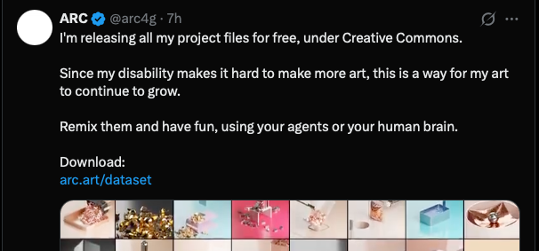

## Summary
3D artist ARC (@arc4g) released all of their 3D art project files for free under Creative Commons, inviting people to remix them by hand or with AI agents. Their disability makes it hard to keep making art, so this lets the work keep growing. The previews show glossy abstract 3D renders: gold and rose-gold metallic shapes, pastel blocks, pink and blue scenes.

Screenshot of ARC's X post: "I'm releasing all my project files for free, under Creative Commons... Remix them and have fun, using your agents or your human brain. Download: arc.art/dataset", with a grid of render thumbnails. The page itself blocked automated fetching, so this summary is from the screenshot.

## Raw
https://arc.art/dataset/
(plus screenshot of the X post)

## Notes
Check the exact CC licence on the download page before reusing in a paid project.
