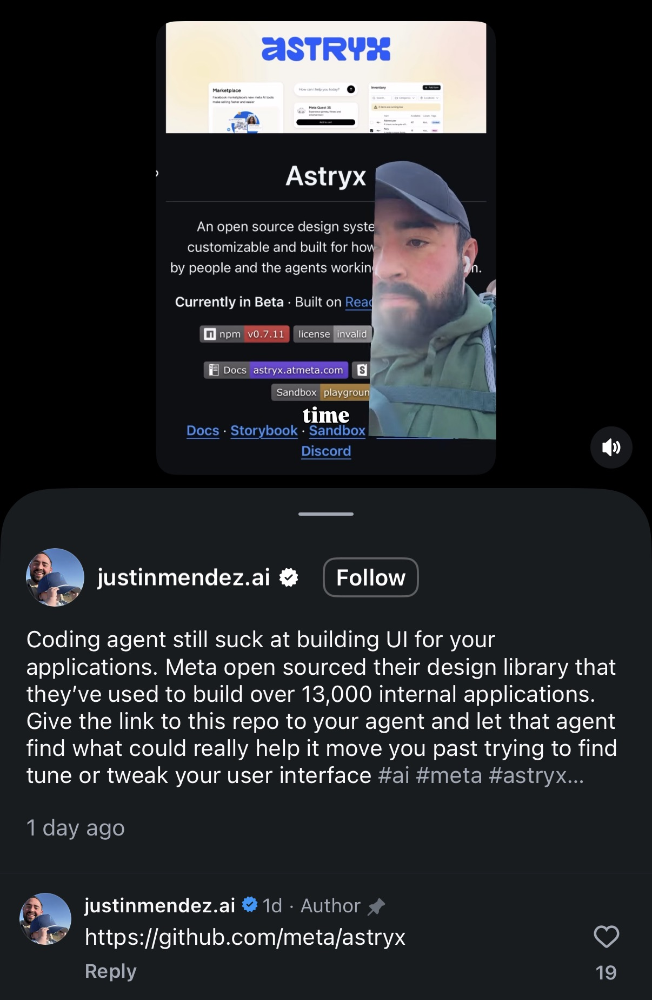

## Summary
Astryx is Meta's open-source (MIT, beta) design system, used inside Meta for eight years across 13,000+ apps. It ships 150+ accessible React components built on StyleX, brand theming, dark mode, templates and a CLI, made to be used by both people and coding agents. Saved because the tip is to hand the repo to your coding agent so it builds better UI. Docs, Storybook and sandbox at astryx.atmeta.com.

Screenshot of a justinmendez.ai video post showing the Astryx README ("An open source design system... built for how we build now: by people and the agents working alongside them"), with his caption that coding agents still suck at UI, and a pinned comment linking github.com/meta/astryx.

## Raw
Link in photo
(screenshot of the post)

## Notes
Could help with UI for the Revolio Labs site, see [[2026-11-10-revolio-labs-vfx-feature]].
