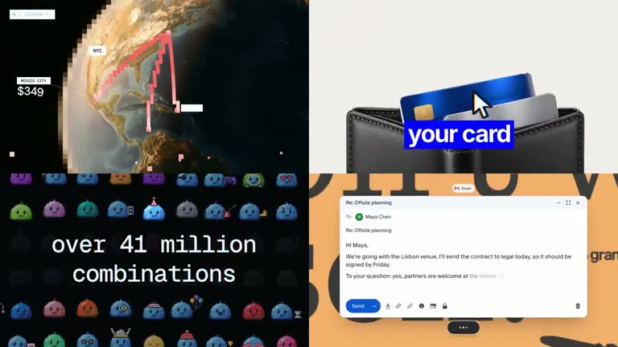

## Summary
A 14-second showreel from Ace Of Frames, a studio that makes product launch videos for startups (aceoframes.com). It plays four launch videos at once in a 2x2 grid, mixing bold type, UI mockups, pixel-art mascots, glowing cards and photo backdrops, and the caption jokes that even AI can't match their taste. Saved as visual design inspiration.

Video frame: a 2x2 grid. Top left is a pixelated flight-route line over a globe with a "$349 Mexico City" price tag. Top right is a cursor dropping a blue card into a black wallet with a "your card" label. Bottom left is a wall of blue pixel blob mascots with "over 41 million combinations". Bottom right is a Gmail reply draft on an orange background. Other frames show "Let agents buy" with a glowing Agentcard, "Approve with Face ID", a Slack composer with a voice-dictation pill, and fn-key dictation shortcuts.

## Raw
https://x.com/aceoframes/status/2120280507778777140?a=YSqWmt6sTY3Ox_qRrUA&s=20

cool visual design

## Notes
- Studio site: https://aceoframes.com
- Read via Social Reader (2-post thread + video frames).
- Related: [[2026-11-10-ladybug-vfx-app]]
