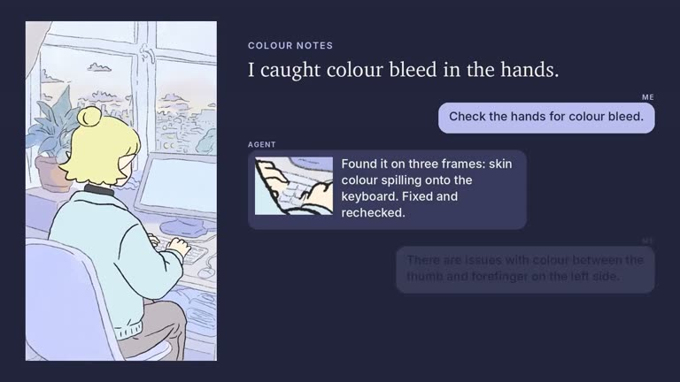

## Summary
Araminta (Alvdansen Studio) shows in a 2-minute video how she uses her "AI Assisted Tween & Paint" harnesses for 2D hand-drawn animation. She starts from a key drawing (line art over a painted background), the agent works directly inside Toon Boom Harmony to tween and colour the shot, and she gives notes in plain words that it fixes, like colour bleed in the hands. The workbook is on the studio's Patreon, and more videos are coming on their YouTube.

Video frame: a painted 2D shot of a blonde character typing at a desk by a window, next to a chat where she says "Check the hands for colour bleed" and the agent replies that it found skin colour spilling onto the keyboard on three frames and fixed it. Other frames show the key drawing, the line-art stage and the Toon Boom Harmony timeline.

## Raw
https://x.com/araminta_k/status/2120216869005324667?a=FODxLrHPUf_yIp5MxOs&s=46

## Notes
- Workbook (Patreon): https://www.patreon.com/alvdansenstudio/posts/ai-assisted-174867377
- YouTube: https://www.youtube.com/@alvdansenstudio
- Read via Social Reader (3-post thread + video frames).
- Related: [[2026-11-11-procedural-arm-rig-demo]]
