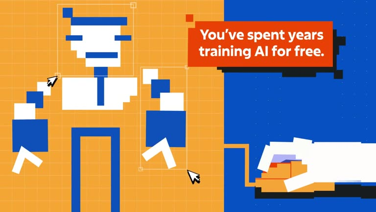

## Summary
A 17-second animated launch film shared by Austin Bauwens, titled "Captchas aren't what you think they are". It argues that solving captchas has been unpaid AI training, from labelling people to steering self-driving cars. The look is flat chunky pixel-art in orange, blue and periwinkle, with captcha grids, bounding boxes, pixel cursors and a car driving a top-down map. Directed by Sam Essanoussi, with design and animation by Justin De Leon and Connor Roy-Shaw. Saved as motion and visual design inspiration.

Video frame: a pixel-art man in a tie on an orange grid with bounding boxes and cursors around him, a hand clicking a mouse on a blue background, and an orange caption reading "You've spent years training AI for free." Other frames show "You aren't just proving you're human" over a captcha tile grid, and a blue car seen from above with a sensor cone, being steered by pixel cursors along a pale map.

## Raw
https://x.com/AustinBauwens/status/2119800432797118696?a=VBH231t4byICoSFXMTU&s=20

cool visuals , launch film

## Notes
- Read via Social Reader (single post + video frames).
- Related: [[2026-11-11-ace-of-frames-reel]]
