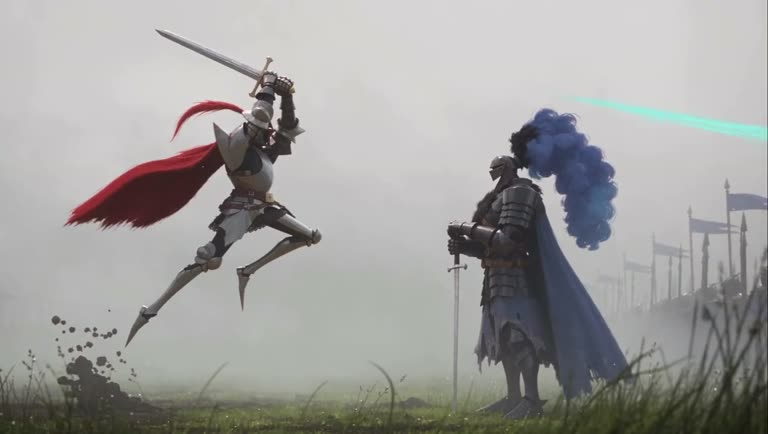

## Summary
"The Impossible Weapon", a ~34-second animated short by INK (@ink.industries_) and Pascal Gautier, made with Krea AI. Two stylised armoured knights face off on a misty, grassy battlefield: a hulking dark knight with a blue plume and a nimble silver knight with a red cape who leaps in with a sword. Saved for its art style for animation: painterly stylised 3D that feels like a hand-made animated feature.

Frames: (1) the dark knight in a fur mantle and blue cape, a huge blue plume on his helmet, standing over a sword in front of rows of faded soldiers and blue banners in fog; (2) a close-up of a giant blade slamming into mud, dirt flying, with thin red ink outlines on the metal; (3) the red-caped silver knight leaping mid-air with sword raised at the still dark knight, a teal streak across the sky; (4) a low-angle shot of the silver knight with a red plume and cross belt buckle raising a fist. Muted grey-green palette, soft fog, foreground grass, punchy red and blue accents.

## Raw
https://www.instagram.com/reel/Dfm8H07Pohc/?xtok=MThoNHJsMmRzdGF5eQ==

Brilliant art style for animations

## Notes
- Caption: "THE IMPOSSIBLE WEAPON. Made with @krea_ai. By INK and @pascal_gautier"
- Read via Social Reader (caption + 4 video frames).
- Related look: [[2026-11-09-blender-mcp-storybook-hero-workflow]]
