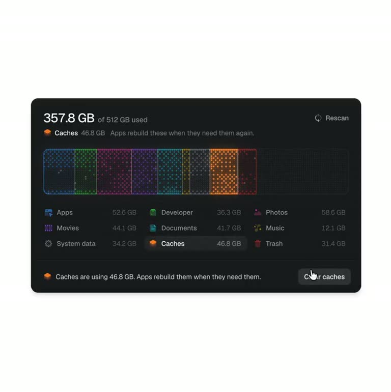

## Summary
A short demo from keshav (@kshvbgde) of a Mac storage scanner: "storage scanner so good you'll want to fill your disk." One dark card shows used space (e.g. 357.8 GB of 512 GB) as a glowing dot-matrix bar split into colour-coded categories (Apps, Developer, Photos, Movies, Documents, Music, System data, Caches, Trash). Hovering a category explains it in plain words and offers one action ("Clear caches", "Empty Trash"); clearing makes that segment's dots scatter away like particles. Saved as the UI to copy for a disk-cleanup app.

Frame: "289.1 GB of 512 GB used, Emptying the Trash ~/.Trash/Old exports". The bar's blue, green, pink, purple, teal, yellow and grey segments are made of tiny glowing dots, and the red Trash segment is bursting into particles at its right edge. Below, a three-column list of categories with icons and sizes, and a footer: "The Trash is holding 31.4 GB of things you've already deleted" with an "Empty Trash" button. Other frames show a "Calculating ~/Pictures/Photos Library/resources" scanning state and "Looking for things you can clear".

## Raw
https://x.com/kshvbgde/status/2120782192385355974?a=esFxqha7hweCnA-1X1s&s=46

If I ever make a disk utility app to remove cache and disk cleanup, this UI is really nice for it.

## Notes
- Read via Social Reader (post text + 4 video frames, 18.6 s video).
- For: [[2026-11-12-disk-cleanup-app]]
