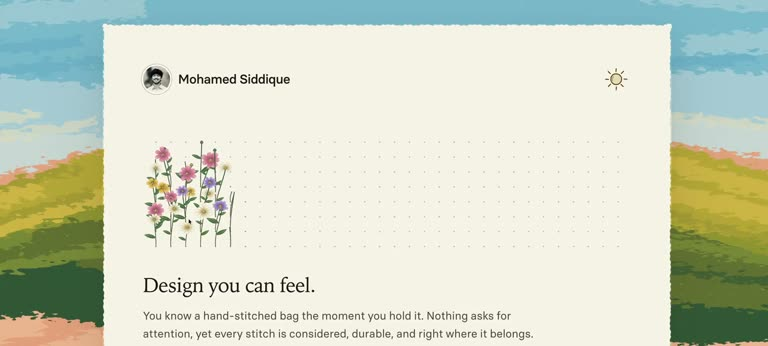

## Summary

A 14-second clip from designer Mohamed Siddique "experimenting with different styles" for a personal site. A cream, paper-textured card with rough torn edges sits over a brushy painted landscape of blue sky and green-yellow hills. Inside, hand-drawn wildflowers (pink, yellow, purple) grow up from a dotted grid, sway and wither away, above a serif headline "Design you can feel." and a short line about a hand-stitched bag. A small sun icon sits top right as the theme toggle.

## Raw
https://x.com/msiddique26/status/2120936635856752710?a=GwvEyei1_uCW0hST4Sg&s=20

## Notes
- Post text: "Experimenting with different styles. Let's see what blooms! 🌸"
- Related: [[2026-11-12-people-of-bengaluru-site]]
