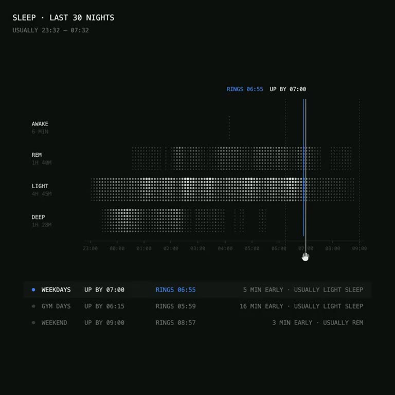

## Summary
A 20-second UI concept by Charles Postiaux (@PostiauxCharles) for a sleep-cycle-based alarm. A dark screen plots the last 30 nights as dot-matrix bands for awake, REM, light and deep sleep, and you drag a vertical "up by" line along the timeline; a blue line shows when it actually rings (a few minutes early, timed to light sleep). Below it, presets for weekdays, gym days and weekend each show their up-by time, ring time and why. Saved as a dark data-viz UI reference.

Video frame: near-black background, small white monospace caps "SLEEP · LAST 30 NIGHTS / USUALLY 23:32 – 07:32". Four rows (AWAKE 6 MIN, REM 1H 40M, LIGHT 4H 45M, DEEP 1H 28M) drawn as grey and white dot grids over an hourly axis from 23:00 to 09:00. A cursor drags a white line at 07:00 with a blue line just before it labelled "RINGS 06:55 UP BY 07:00". Below: a list with WEEKDAYS (selected, blue dot) up by 07:00, rings 06:55, "5 min early · usually light sleep"; GYM DAYS up by 06:15, rings 05:59; WEEKEND up by 09:00, rings 08:57, "usually REM".

## Raw
https://x.com/PostiauxCharles/status/2121248954260267411?a=dqYMENsunRd2qlnudcQ&s=20 cool design

## Notes
- Read via Social Reader (single post + video frames).
- Related: [[2026-11-12-storage-scanner-ui]] (same dark dot-matrix data-viz look)
