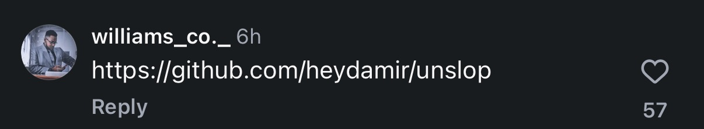

## Summary
unslop by Damir Sokolovsky (@heydamir) is an open-source skill for Claude Code and Codex that turns vibecoded, AI-looking UI into a designed interface. It first audits the screen for slop signs (purple gradients, glows, emoji labels, loud copy, uneven spacing), proposes a visual direction that fits the product, then revises in a fixed order: spacing, colour, icons, copy, type, layout, details, visuals, motion. It can also generate hero images through fal, Replicate, OpenAI or Higgsfield, asking before each paid generation, and render a short before/after video with Playwright and ffmpeg. It works with React, Next.js, Vue, Svelte, Tailwind or plain HTML/CSS, or from a live URL. Install it into `~/.claude/skills/` and run `/unslop`. License is CC BY 4.0; about 6.5k stars.

The screenshot is an Instagram comment on the reel by williams_co._ that just posts the link github.com/heydamir/unslop (57 likes).

## Raw
This is the GitHub repo he was talking about in the latest reel link I sent.
(screenshot of a comment: https://github.com/heydamir/unslop)

## Notes
From the reel: [[ai-slop-design-rules]]
