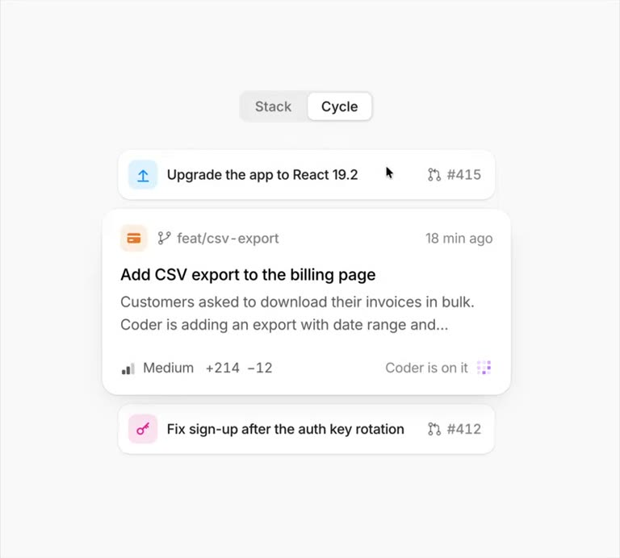

## Summary
Flo (@flohoeller) shows an "Agent Issue Stack" UI component: a deck of issue cards, one per task an AI agent is working on. A Stack / Cycle toggle switches between a stacked deck you page through (1 / 6) and a cycling list where the focused card expands. Each card shows the PR or branch, title, a short status line, priority, diff size and which agent is on it.

Frame: light theme, Cycle mode. Compact rows above and below ("Upgrade the app to React 19.2 #415", "Fix sign-up after the auth key rotation #412"), and the expanded middle card "Add CSV export to the billing page" on branch feat/csv-export, 18 min ago, Medium, +214 −12, "Coder is on it" with a small purple pixel-dot avatar. Other frames show the dark theme, the Stack mode with prev/next arrows, and agents named Triage, Upkeep and Watchdog, each with its own coloured dot-grid icon and an Urgent priority in red.

## Raw
https://x.com/flohoeller/status/2126273476830875663?a=fbcTpb8TTI6JzyCk1mo&s=20

## Notes
- [[agentic-toasts-ui]]: another UI for showing what agents are doing
- [[tessera-dark-dashboard-ui]]: work-item cards and status pills in a project dashboard
- [[astryx-design-system]]: component kit built for agent UIs
