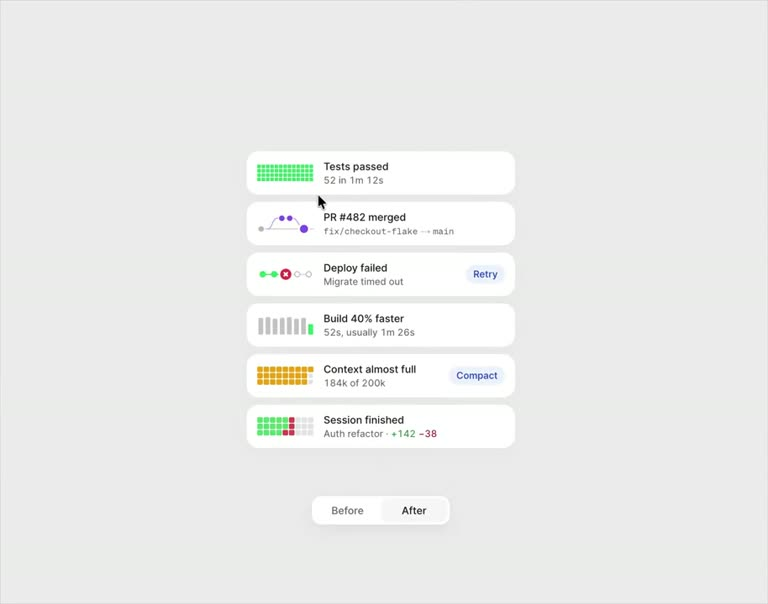

## Summary
Phil Pitus's before/after of "agentic toasts": notification cards for coding-agent events (Claude finished a session, tests passed, PR merged, deploy failed, context almost full). Before: standard toasts with a generic icon, title, time and a button. After: each toast has a small data glyph that shows the state itself, so you read it at a glance. Posted as "Why your AI still needs designers".

Frame (After): a stack of white rounded cards on light grey. Tests passed shows a green grid of 52 dots, PR merged a little purple branch graph, Deploy failed a row of step dots with a red X and a Retry chip, Build 40% faster a bar chart with one green bar, Context almost full an amber grid nearly filled with a Compact chip, Session finished a green/red grid for +142 −38 lines. A Before/After pill toggle sits underneath.

## Raw
https://x.com/pitus_/status/2125962627822100496

## Notes
- [[unslop-ui-skill]]: same point, AI-made UI needs a designer's eye
- [[storage-scanner-ui]]: another small utility UI saved for its look
- [[tessera-dark-dashboard-ui]]: both visual-design, ui
- [[agent-issue-stack-component]]: both visual-design, ui, agents
