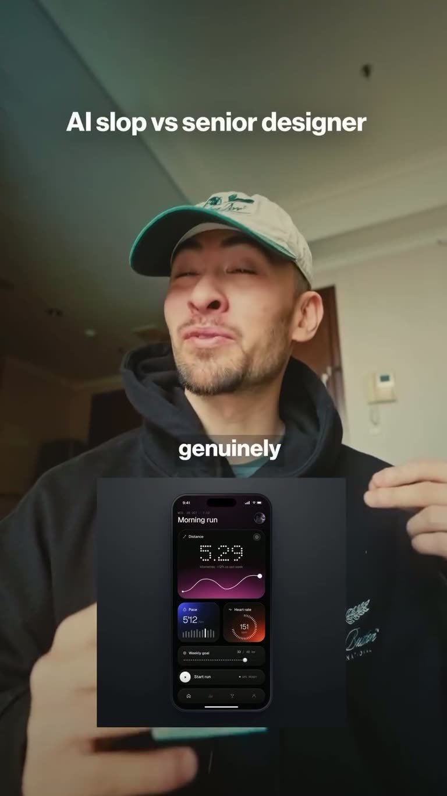

## Summary
Reel by @anthonyalxnder comparing generic "AI slop" UI with what a senior designer gets by giving the AI design knowledge as rules. He shows polished results, like a dark running-app screen and a glassy phone UI, and covers points such as using a proper range of font weights (Thin 100 to Black 900). The caption offers his 9 design rules and the original skill repo to anyone who comments "slop", so the full list and repo aren't in the reel itself.

The frame shows him holding up a dark "Morning run" app mockup: a big dot-matrix 5.29 km distance on a purple gradient wave chart, pace and heart-rate cards, a weekly goal slider and a Start run button.

## Raw
https://www.instagram.com/reel/Dfu-teMSFrr/?xtok=MW45cXQ1b3c2enB4aw==

## Notes
The skill repo from the reel is [[unslop-ui-skill]] (github.com/heydamir/unslop). Related: [[astryx-design-system]], [[cinematic-film-skill]]
