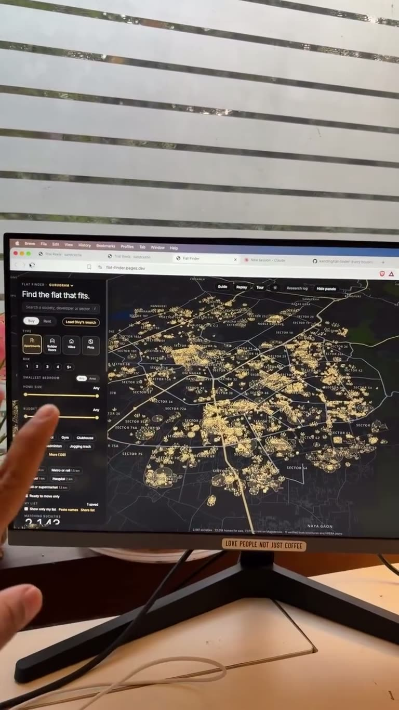

## Summary

A 71-second reel by @divy.kairoth ("Ep 2 claude maxxingg") showing Flat Finder (flat-finder.pages.dev), a web app he built with Claude for finding a flat in Gurugram. The screen shows a full-screen dark map where every housing society glows as gold dots and 3D tower shapes, with a dark left sidebar ("Find the flat that fits.") of filters for buy/rent, type, BHK, bedroom size, budget, amenities and distance to metro or hospital, plus a matching-societies counter. Zooming in turns the dots into extruded buildings with a detail card (price, score, unit sizes). The open-source repo (github.com/kairothq/flat-finder) README explains the data: ~2,700 projects from Magicbricks, building outlines from OpenStreetMap, and bedroom sizes read from builder brochures and HRERA plans via OCR, with colours meaning match, likely, unchecked or no match.

## Raw
https://www.instagram.com/reel/Df7M6XfTQIy/?lqvp=MXJjMmJndDAwcm81Ng==

## Notes
- Caption: "Ep 2 claude maxxingg"
- Site: https://flat-finder.pages.dev
- Repo: https://github.com/kairothq/flat-finder (Python, JavaScript, CSS)
