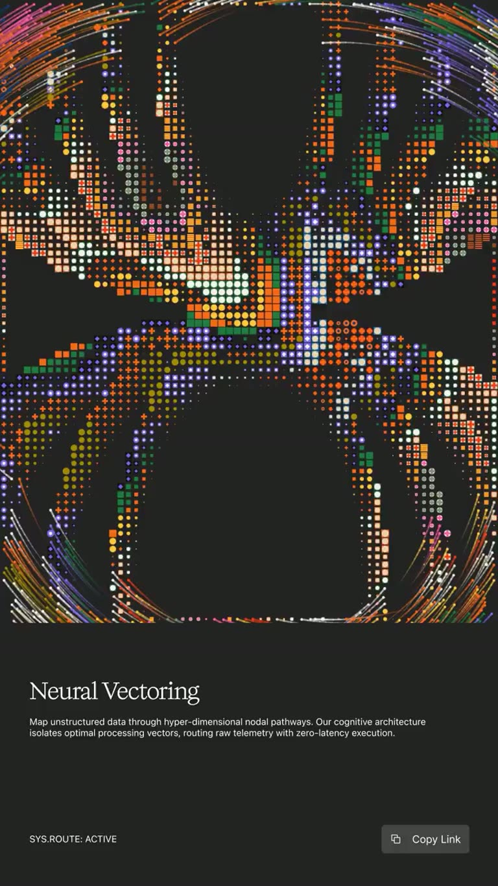

## Summary
Praveen Kumar (@praveenisomer) posted four animated vertical cards from an early brand exploration for a neural-network company. Each card is mostly a generative data visualization, with a serif title, a line of copy and a small caps action label underneath:
- **Neural Vectoring:** a symmetric web of tiny dots, squares and crosses in orange, purple, green and cream on charcoal, with coloured arcs sweeping over it.
- **Cognitive Node Clustering:** green, blue and orange tiles with pink edges, warping like a 3D surface on white.
- **Asymmetric Decryption:** a single-blue swirl of streaks that resolves into a glyph grid.
- **Volumetric Data Mapping:** a dense treemap of number-filled boxes in green, pink and orange.

The frame shows the Neural Vectoring card: a multicolour glyph grid shaped like a branching network on a charcoal background, titled "Neural Vectoring" with a "Copy Link" button.

## Raw
https://x.com/praveenisomer/status/2121566361021530366

## Notes
The thread's second post is just the author's booking link.
