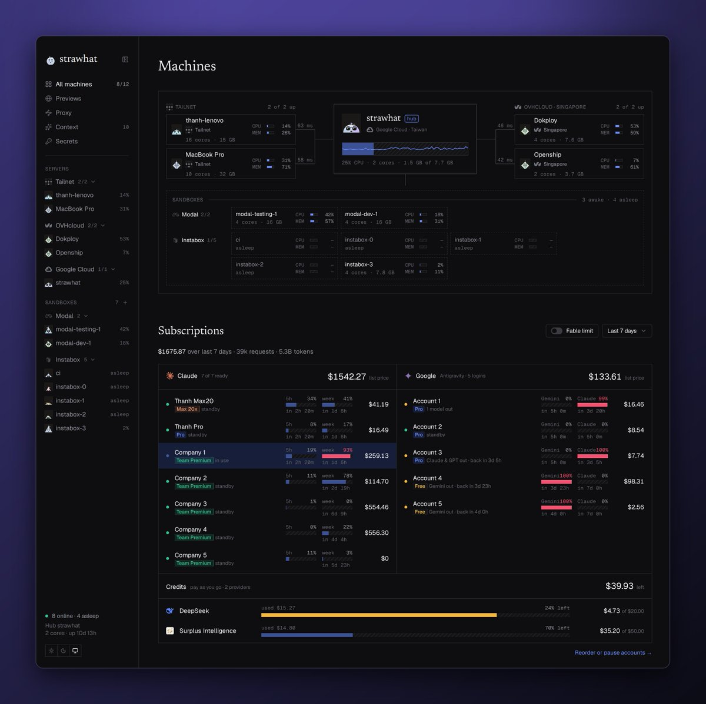

## Summary
Thanh Doan (@capythanh) vibe coded "strawhat", a personal homelab dashboard that puts all his machines and AI accounts in one place: workstations, cloud servers and sandboxes with live CPU and memory, plus every Claude and Antigravity subscription with 5-hour and weekly usage limits and pay-as-you-go credits. His point: the best side project is the one only you use.

Screenshot: a dark UI on a purple gradient. Left sidebar lists machines, previews, proxy, context, secrets and server groups (Tailnet, OVHcloud, Google Cloud) and sandboxes (Modal, Instabox) with CPU %. The "Machines" section is a node map: a central "strawhat hub" card with a CPU sparkline wired to laptops on the left and Singapore servers on the right, with latency labels, and a dashed sandbox area with awake/asleep boxes. Below, "Subscriptions" shows $1675.87 over 7 days split into Claude and Google columns, each account with small blue/red usage bars, reset timers and cost, and a Credits strip with yellow and blue progress bars for DeepSeek and another provider.

## Raw
https://x.com/capythanh/status/2121965442063294958?a=VHwQFfmc4LECF2s1hrI&s=20

## Notes
Idea: a similar one-page dashboard for my own projects, deploys and AI accounts.
