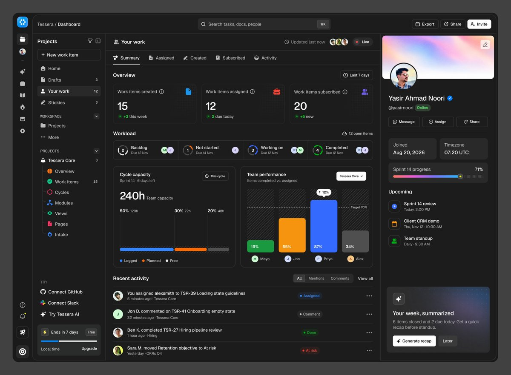

## Summary
Product designer Yasir Ahmad Noori (@yasirahmadnoori) shared a dashboard shot for "Tessera", a fictional project-management app, calling it one of the best dashboard designs you'll ever see. The second post in the thread is just a pitch for his design services.

Screenshot: a near-black three-column layout. Left: a slim icon rail plus a Projects sidebar (Home, Drafts, Your work, Stickies, a Tessera Core tree with Overview, Work items, Cycles, Modules, Views, Pages, Intake, and Connect GitHub / Slack / Try Tessera AI at the bottom). Centre: "Your work" with tabs (Summary, Assigned, Created, Subscribed, Activity), three stat cards (15 created, 12 assigned, 20 subscribed) with coloured icons, a Workload strip of four ring-progress chips (Backlog, Not started, Working on, Completed) with avatars, a "Cycle capacity" card (240h, logged/planned/free bars), a "Team performance" bar chart with hatched backgrounds, a dashed 70% target line and a "+12%" bubble over the blue bar, and a Recent activity list with green/red/blue status pills. Right: a profile panel with a pastel gradient banner, avatar, Message/Assign/Share buttons, Joined and Timezone tiles, a Sprint 14 progress slider in a red-to-blue gradient, an Upcoming list, and a "Your week, summarized" AI recap card with a Generate recap button.

## Raw
https://x.com/yasirahmadnoori/status/2126184712376848740?a=bucbUEoBzZ_fGlSVdXA&s=20

## Notes
- [[strawhat-homelab-dashboard]]: another dark dashboard reference, for a personal tool
- [[storage-scanner-ui]]: dark compact utility UI with colour-coded bars
- [[agentic-toasts-ui]]: same AI-in-the-UI touch as the "Your week, summarized" card
