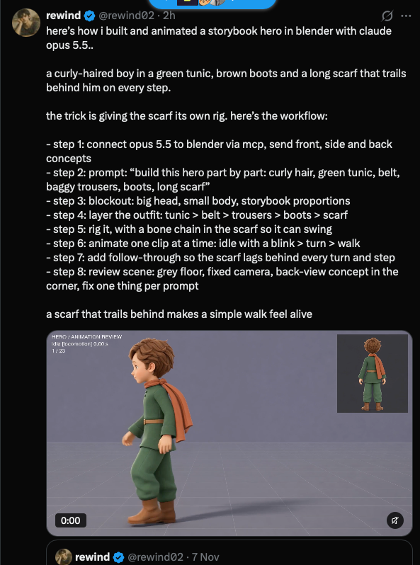

## Summary
@rewind02 built and animated a stylised storybook hero (curly-haired boy, green tunic, brown boots, long orange scarf) in Blender by driving it with Claude Opus 5.5 through the Blender MCP. The key trick: give the scarf its own bone chain so it trails and swings behind every step. Saved as a repeatable 8-step character workflow for Yuvraj's games.

### The workflow (from the post)
1. Connect Claude to Blender via MCP; send front, side and back concept images.
2. Prompt: "build this hero part by part: curly hair, green tunic, belt, baggy trousers, boots, long scarf".
3. Blockout: big head, small body, storybook proportions.
4. Layer the outfit in order: tunic > belt > trousers > boots > scarf.
5. Rig it, with a bone chain in the scarf so it can swing.
6. Animate one clip at a time: idle with a blink > turn > walk.
7. Add follow-through so the scarf lags behind every turn and step.
8. Review scene: grey floor, fixed camera, back-view concept in the corner; fix one thing per prompt.

"A scarf that trails behind makes a simple walk feel alive."

## Raw
https://x.com/rewind02/status/2119821740058546282?a=4tYjy-hUHaGuRBuPsQw&s=20

(with a screenshot of the post, saved above)

## Notes
- Related: [[2026-11-09-godot-waterfall-texture-array-shader]], [[2026-11-09-pixel-search-sprite-database]]
