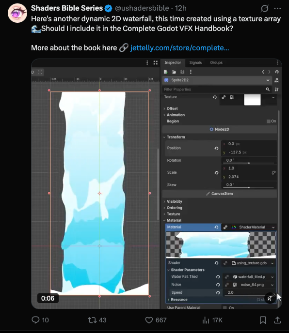

## Summary
Shaders Bible Series (@ushadersbible) shows an animated 2D waterfall in Godot: a Sprite2D with a ShaderMaterial (`using_texture`) that takes a tiled waterfall texture array, a `noise_64.png` noise texture and a `speed` parameter (2.0). It's a teaser for their Complete Godot VFX Handbook at jettelly.com. Handy reference for stylised water in Yuvraj's games.

## Raw
https://x.com/ushadersbible/status/2119673988464922969?a=s-74g2GGB1j52MU2CyE&s=20

(with a screenshot of the post, saved above)

## Notes
- Book: Complete Godot VFX Handbook, jettelly.com/store
- Related: [[2026-11-09-pixel-search-sprite-database]] (2D game assets)
