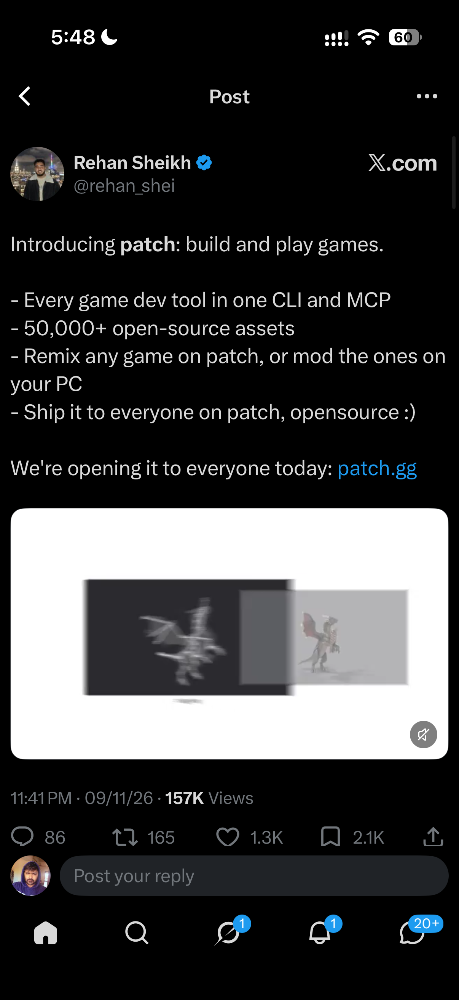

## Summary
Patch (patch.gg), launched by Rehan Sheikh (@rehan_shei), is a platform to build and play games. It bundles every game dev tool into one CLI and MCP, ships 50,000+ open-source assets, lets you remix any game on patch or mod games on your PC, and publishes them open source to everyone on patch.

Screenshot of the X post announcing patch ("opening it to everyone today"), with a demo video still of a grey 3D dragon model next to a textured red dragon. Posted 09/11/26, 157K views, 2.1K bookmarks.

## Raw
https://x.com/rehan_shei/status/2119855388988518794?a=qlXTpSq4hRphE0FQXIw&s=46
(plus screenshot of the post)

## Notes
Related: [[2026-11-09-pixel-search-sprite-database]], [[2026-11-09-blender-mcp-storybook-hero-workflow]]
