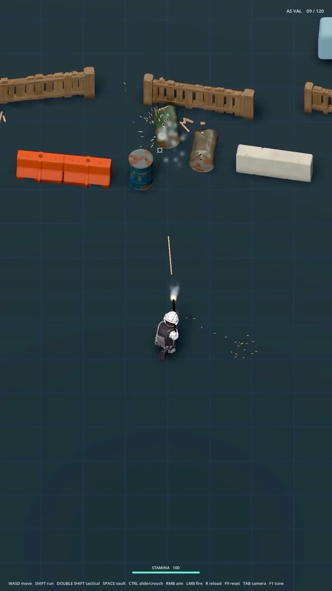

## Summary
A devlog reel from @lastmaglab of an indie top-down tactical shooter made in Godot. A soldier in white-and-black gear shoots oil barrels that now have physics: they tip, roll and get punched with bullet holes, while splinters and shell casings scatter. The art style is clean stylised 3D on a dark slate grid floor, with chunky wooden fences, orange plastic and white concrete barriers, a minimal HUD and a teal stamina bar. Saved for its visual and art style.

Video frame: top-down view of the soldier firing an AS VAL rifle (ammo 09/120) at three rusty blue and green barrels in front of wooden fences, with muzzle flash, a tracer, debris and brass casings on the floor. The HUD lists the controls: WASD move, shift run, double shift tactical, space vault, ctrl slide/crouch, RMB aim, LMB fire, R reload, TAB camera.

## Raw
https://www.instagram.com/reel/Dfl14Swvt7W/?psln=MWZiMWFlZzhndGRyZg==

Cool game visual style, art style.

## Notes
- Caption: "The barrels have physics now. They're having a blast. The barriers? Still haven't stopped a damn thing except my productivity. (yes they are plastic barriers)" #godotengine #indiegamedev
- Read via Social Reader (caption + video frames).
- Related: [[2026-11-09-godot-waterfall-texture-array-shader]]
