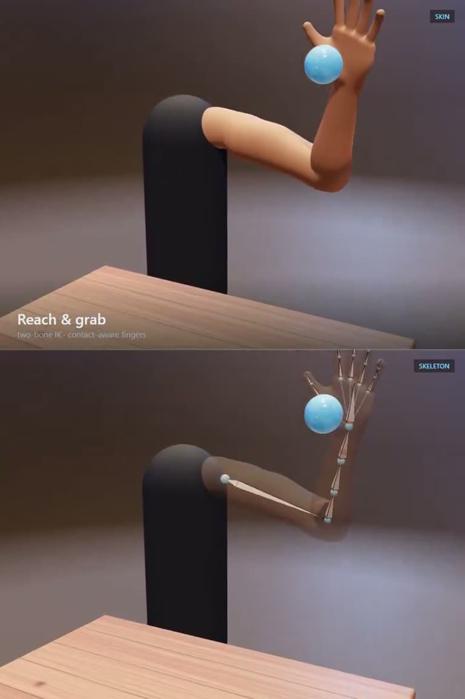

## Summary
@apekshik used an AI model to build one highly detailed, open-source rigged arm instead of "one-shotting" a whole game: realistic bone armature, weight-painted mesh, volume-preserving joints and muscles that swell as the fist tightens. The arm uses two-bone IK (you set the hand target, it solves shoulder and elbow) while the 38-bone fingers use FK, curling joint by joint and stopping on contact, so it can reach, grab and place a ball on a table. Live demo at procedural-arm-rig.vercel.app, code at github.com/apekshik/procedural-arm-rig, free to reuse in your own games.

Video frame: a skin-shaded arm on a dark post reaching for a blue ball above a wooden table ("Reach & grab, two-bone IK, contact-aware fingers"), with a skeleton view below. Other frames show pick & place, a clenched fist, a finger wave, and a rainbow weight-paint view.

## Raw
https://x.com/apekshik/status/2120224530367119758?a=ChwWhzRfVZVOzMcLw7g&s=20

try w this link in a new thread'

## Notes
- Demo: http://procedural-arm-rig.vercel.app
- Repo: https://github.com/apekshik/procedural-arm-rig
- Read via the Social Reader connector (post text, 2-post thread, video frames).
- Related: [[2026-11-09-blender-mcp-storybook-hero-workflow]]
