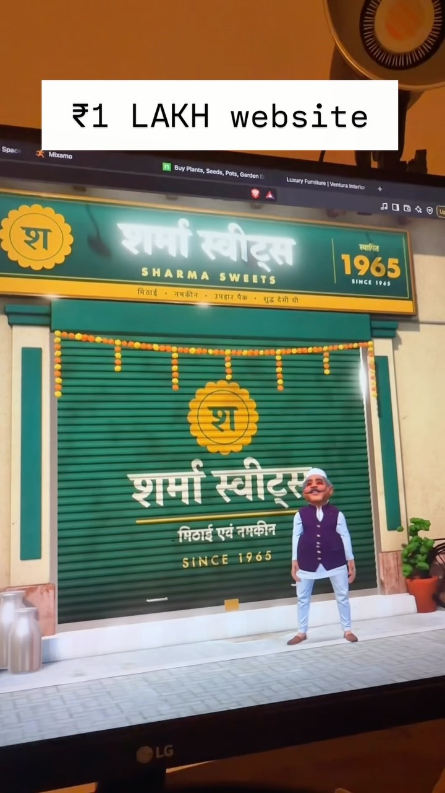

## Summary
A reel from @thesoloentrepreneur.yt showing a "₹1 lakh website": a 3D web scene of an old Indian sweet shop, "Sharma Sweets, since 1965", with a stylised cartoon Lala ji (big moustache, white Gandhi cap, purple Nehru jacket, white kurta) standing in front of the shuttered shop. Saved as the art style reference for his Tukaram Munde game: stylised cartoon 3D, everyday Indian street settings, caricature characters.

Video frame: a monitor showing the 3D scene. A bottle-green signboard with Devanagari and English lettering ("शर्मा स्वीट्स / SHARMA SWEETS", "1965"), a green rolling shutter with a yellow "श" logo, a marigold garland strung across the top, milk cans on the left, a potted plant on the right and a paved footpath. The caricatured shopkeeper stands centre-right, Mixamo-style posed. Warm, soft lighting.

## Raw
https://www.instagram.com/reel/DfnlqQLS7mD/?vrfl=dTQ0MzhyY2pkNnl4

Art style reference for Tukaram Munde game.

## Notes
- Caption: "Comment “LalaJi” for playbook" (the reel is pitched as a 3D website build; the browser tabs show Mixamo, so the character is likely rigged/animated with Mixamo).
- Read via Social Reader (caption + one video frame).
- For: [[2026-11-12-tukaram-munde-game]]
- Related look: [[2026-11-09-blender-mcp-storybook-hero-workflow]]
