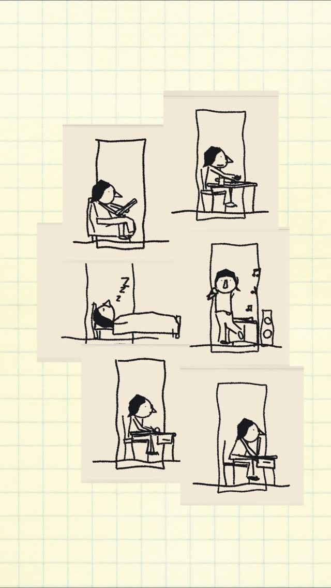

## Summary
Reel by @shubhastudios showing how they built the animation system for two characters, "little lady & little dude", in an ongoing series of interactive storytelling projects. The characters are animated from motion capture with Mixamo integration and drawn as hand-drawn line art.

The thumbnail shows six cream paper cards on yellow grid paper, each a doorway-shaped frame with a scribbly black-ink character doing everyday things: reading in an armchair, sleeping (zzz), singing next to a speaker, typing at a desk. Only the cover image could be read; the video itself didn't download.

## Raw
https://www.instagram.com/reel/DfoIiH5R7Mo/?psln=eG8zY2RnZG1iaHFn

Cool line art animation workflow with motion capture and Mixamo integration also.

## Notes
- Related: [[2026-11-13-toyxyz-blender-retargeter]] (mocap retargeting in Blender)
