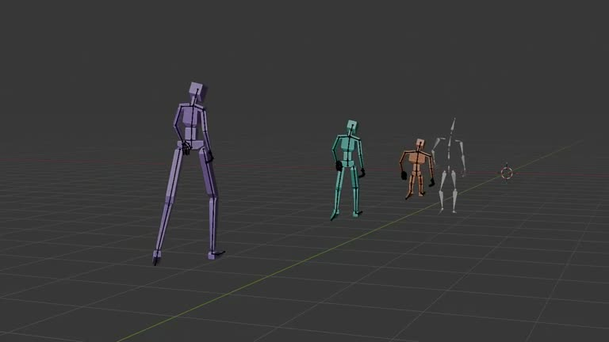

## Summary
A free Blender add-on by @toyxyz3 that retargets mocap between characters with very different body proportions (tall, short, stocky). It copies joint rotations with FK, then adjusts the root motion for each rig's limb lengths, so feet don't slide and you avoid the IK popping of IK-based retargeting. Code: https://github.com/toyxyz/toyxyz-blender-retargeter

The video shows four mannequins walking side by side on Blender's dark grid: a tall lilac one, a teal one, a small orange one and a white bone-only rig. All are built from simple boxy segments with black hands, one flat colour each, which is the clean prototype-character look he liked.

## Raw
https://x.com/toyxyz3/status/2120734403605500312?a=0clsilseM9lnGap0uvo&s=20 Cool plugin, and also cool way to retarget motion between characters with different body proportions in

Also, this is a very cool art style for showing prototype models in a

I said in a game.

## Notes
- Related: [[2026-11-13-line-art-mocap-workflow]] (another mocap animation workflow)
