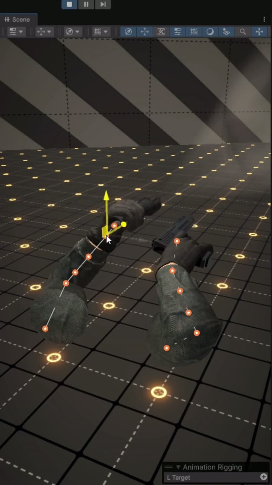

## Summary

A @gamedevinspire reel showing bodycam-style first-person hands in Unity driven entirely by IK, "not even a single animation clip". Both arms use Unity's Animation Rigging package with IK targets; an Aim Target parented under the camera makes the gloved hands and pistol follow where you look, with the weapon lagging a few degrees for that shaky bodycam feel. The project files are offered via comment.

The frame shows the Unity Scene view: two gloved arms with orange bone joints, a move gizmo on the left hand's IK target, a pistol in the right hand, a black-and-white striped wall and a dark floor with glowing orange dots; the Animation Rigging panel shows "L Target".

## Raw
https://www.instagram.com/reel/DfpPiVxiVWy/?srtk=cjFtdWFjbW9tNXNy

The link I just shared is tips for hand animation in a first person view in Unity.

## Notes
- Related: [[2026-11-11-procedural-arm-rig-demo]]
