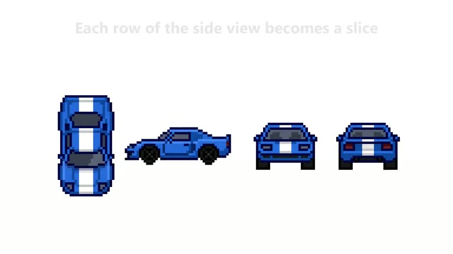

## Summary
Kimo (@asynkimo) shows sprite stacking: slice a pixel-art object row by row from its side view, stack the slices 1 px apart and rotate them together, so a 2D sprite can turn to any angle and looks 3D. The demo is a blue pixel sports car with white racing stripes drifting around a top-down track with red-and-white kerbs and green grass. A follow-up post links a full how-to with the Godot code: https://spritecook.ai/blog/sprite-stacking-pixel-art

The frame shows the car's top, side, front and back views with the caption "Each row of the side view becomes a slice"; a later frame says "Stack the slices 1 px apart and turn them".

## Raw
https://x.com/asynkimo/status/2121716250820964431

## Notes
Related: [[pixel-search-sprite-database]], [[godot-waterfall-texture-array-shader]]
