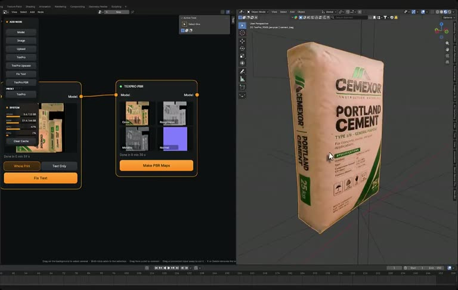

## Summary
A Blender addon in development by Milad Kambari (prototype 11) that textures a bare 3D model from a reference image with AI. It runs on a LoRA trained on about 25,000 3D models and 380,000 renders, and works as a node graph inside Blender: TexPro texture generation (single or multi-view, fast/balanced/ultra), upscale, a Fix Text pass that keeps printed text and fonts legible, and a PBR node that makes colour, roughness, metallic and normal maps. On a 4070 Ti one model took about 4 min to texture, 12 s to upscale, 1 min for the text fix and 30 s for PBR.

Frame from the demo video: Blender with the addon's node panel on the left (TexPro PBR node showing colour, roughness, metallic and normal maps) and a cement bag model on the right, fully textured with sharp "Portland Cement" print and labels.

## Raw
https://x.com/miladkambari/status/2125963905247686742?a=E0JLSZ6hvW1APc0kD0M&s=12

Note: Texture 3d

## Notes
- Not released yet as of 2026-11-26; prototype shown on X.
- [[polyfork-3d-assets]]: another shortcut to game-ready 3D assets
- [[metahuman-maker-agent-addon]]: another AI-driven Blender addon
- [[blender-painterly-leaf-shader]]: Blender look-dev for game assets
