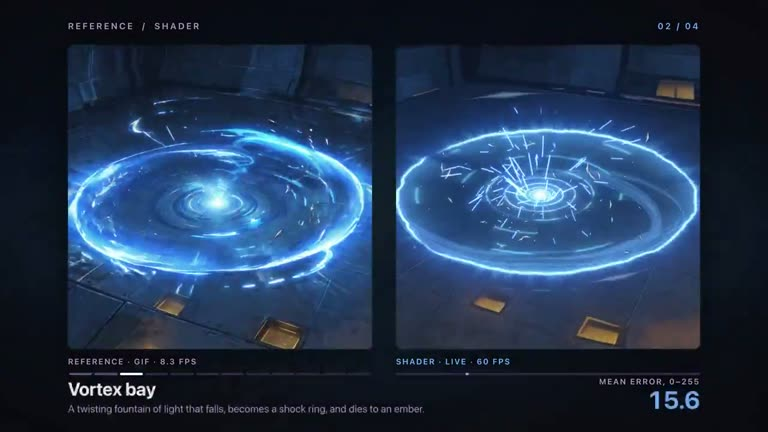

## Summary
AnyVFX by gokayfem is an open-source agent skill (one SKILL.md plus tools and 4 worked examples) that takes a 12-frame VFX GIF and rebuilds it as a single GLSL fragment shader with no textures or buffers: the agent measures the clip, paints the static scene with a light map, then recreates the effect so the shader draws every in-between frame at 60 fps. The source clips come from 256 game-ability prompts (16 categories x 16 abilities): a keyframe image, then a 12-frame GIF from an image model. Repo: https://github.com/gokayfem/anyvfx

Frame from the demo video: "Vortex bay", the reference GIF at 8.3 fps on the left next to the live shader at 60 fps on the right, a swirling blue energy ring on a dark sci-fi floor, mean error 15.6 out of 255.

## Raw
https://x.com/gokayfem/status/2125913091439497243?a=2nz3bacc7o4Tsb_gzGA&s=12

Note: Vfx with ai

## Notes
- [[revolio-labs-vfx-feature]]: AI-made VFX, the same goal from another angle
- [[godot-waterfall-texture-array-shader]]: stylised game effect done in a shader
- [[ladybug-vfx-app]]: another VFX tool to compare against
