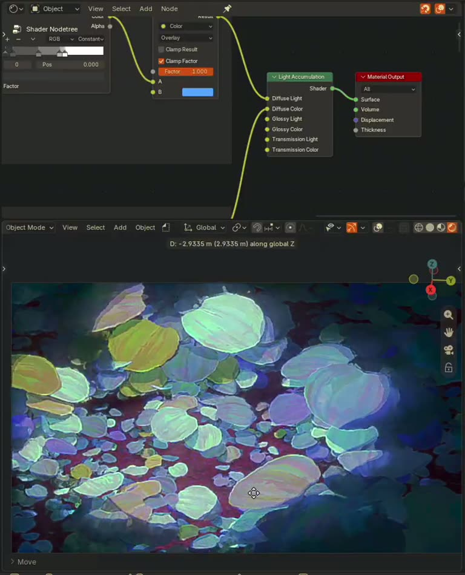

## Summary
Jie (@jiehananana) shows a stylised Blender shader built around the Light Accumulation node ("light accumulation node starts making sense"). Lighting is gathered per surface and remapped through a colour ramp and overlay mix, so a pile of 3D leaves renders like a hand-painted illustration, and moving the light live repaints the scene.

Video frame: Blender's shader editor on top (a colour ramp feeding an Overlay mix node with a light blue B colour, wired into Light Accumulation's Diffuse Light input, then into Material Output) and the rendered viewport below: a dense bed of overlapping round leaves with visible brushstroke texture, glowing mint, teal, pale lavender and yellow-green where lit, fading to dark blue, on a deep crimson ground. Over the 13s clip the light is dragged and the leaves go from dark and muted to brightly lit.

## Raw
https://x.com/jiehananana/status/2121967542499713475?a=3pHJV1sIIbB9VvTVBBI&s=46

## Notes
Related: [[claude-code-paintings]] (painterly look made in code).
